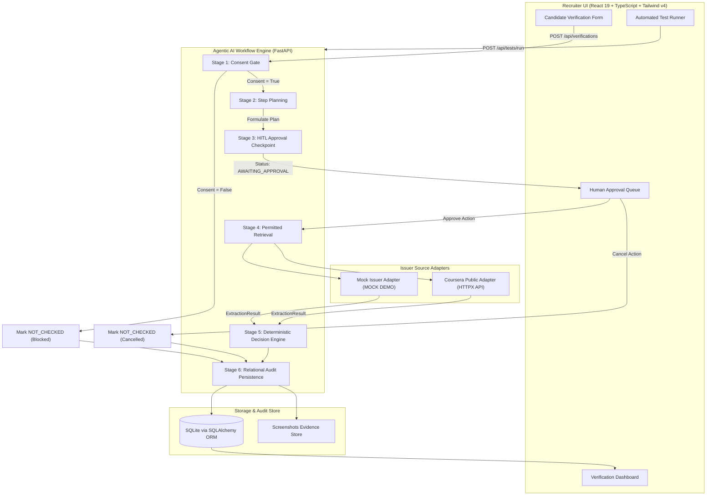

# CertiProof AI — Agentic Certificate Authenticity Checker

[](https://github.com/sanjiv-18/CertiProof-AI-Agentic-Certificate-Authenticity-Checker/actions/workflows/ci.yml)
[](https://certiproof-ai.vercel.app)
[](https://python.org)
[](https://fastapi.tiangolo.com)
[](https://react.dev)
[](https://tailwindcss.com)
[](LICENSE)

> **Ziro.Digital Agentic AI Hackathon 2026**  
> **Team:** Infinity Castle (`F058C58`)  
> **Problem Statement:** Certificate Authenticity Checker  
> **Industry:** Education & Career AI  
> **Live Demo:** [https://certiproof-ai.vercel.app](https://certiproof-ai.vercel.app)  
> **Official Submission Form:** See [SUBMISSION.md](SUBMISSION.md)

---

## 1. Project Overview

### Problem Statement
In technical recruitment and credential screening, resume fraud and manipulated certificate credentials cost organizations millions in bad hires and compliance risk. Existing automated scrapers either aggressively violate platform terms or passively query unverified records. Meanwhile, generative AI solutions hallucinate validation outcomes, falsely accusing genuine candidates or validating counterfeit certificates.

### Proposed Solution: CertiProof AI
**CertiProof AI** is an auditable Agentic AI system designed to help recruiters verify candidate certificate IDs against permitted public course-platform issuer verification portals. 

CertiProof AI rejects "black box" decisions. It executes an explicit **6-stage agentic workflow** governed by:
1. **Mandatory Candidate Consent:** Strict gatekeeper preventing unauthorized lookups.
2. **Transparent Agent Planning:** Discloses target URLs and planned browser steps before navigation.
3. **Human-in-the-Loop (HITL) Authorization:** Pauses execution and requires explicit recruiter approval before querying issuer endpoints.
4. **Permitted Evidence Retrieval:** Gathers verifiable proof using extensible issuer adapters.
5. **Deterministic Decision Engine:** Applies rule-based classification against candidate claims, completely eliminating generative hallucinations.
6. **Relational Audit Persistence:** Records full response payloads, timestamps, and screenshots into an immutable SQLite audit store.

---

## 2. Key Features

- **6-Stage Agent Lifecycle:** Visible, traceable state transitions (`PENDING` $\rightarrow$ `PLANNING` $\rightarrow$ `AWAITING_APPROVAL` $\rightarrow$ `RUNNING` $\rightarrow$ `DONE`).
- **Human-in-the-Loop Approval Queue:** Recruiters review proposed destination URLs and actions prior to execution, preventing accidental or unauthorized lookups.
- **Candidate Consent Enforcement:** If consent is missing, the agent immediately blocks the lookup, logs the refusal as `NOT_CHECKED`, and records an audit trace without pinging the issuer.
- **Deterministic Decision Engine:** Classifies outcomes into five explicit categories: `VERIFIED`, `MISMATCH`, `NOT_FOUND`, `UNRESOLVED`, and `NOT_CHECKED`.
- **Extensible Issuer Adapters:**
  - `MockIssuerAdapter`: Deterministic mock adapter for automated test cases (`TC1`–`TC4`), clearly labeled as `MOCK`.
  - `CourseraPublicAdapter`: Live extraction from Coursera's public credential endpoints using `httpx`.
- **Awwwards-Grade UI Design:** Styled with the `Leonxlnx/taste-skill` design system featuring double-bezel cards, button-in-button controls, JetBrains Mono data tables, and ambient radial glowing surfaces.
- **Automated Test Runner:** In-app runner executing official test cases (`TC1`–`TC4`) with real-time pass/fail evaluation and evidence logs.

---

## 3. System Architecture



For comprehensive architectural specifications, state transitions, and schemas, see [docs/architecture.md](docs/architecture.md).

---

## 4. Repository Structure

```text
CertiProof-AI/
├── api/
│   ├── index.py                 # Vercel serverless FastAPI entrypoint
│   └── pyproject.toml           # Serverless dependency metadata
│
├── backend/
│   ├── app/
│   │   ├── routes/              # Modular API endpoints (verifications, dashboard, issuers, tests)
│   │   ├── services/            # Verification services, issuer adapters, and decision engine
│   │   ├── agents/              # 6-stage autonomous agent execution lifecycle
│   │   ├── models/              # SQLAlchemy database models & Pydantic v2 schemas
│   │   ├── utils/               # Database engine, session helpers, and application configuration
│   │   └── main.py              # FastAPI application entrypoint
│   ├── tests/                   # Backend pytest test suite (11 unit/integration tests)
│   ├── requirements.txt         # Backend Python dependencies
│   └── pytest.ini               # Pytest environment configuration
│
├── frontend/
│   ├── public/                  # SVG icons and static branding assets
│   ├── src/
│   │   ├── components/          # Reusable UI components (Navbar, Sidebar, StatusBadge)
│   │   ├── pages/               # 8 application screens (Dashboard, NewVerification, Approvals, etc.)
│   │   ├── services/            # Axios API service client layer
│   │   ├── hooks/               # Custom React hooks (useDashboard, useVerification)
│   │   ├── utils/               # Display formatters and UI constants
│   │   ├── types/               # TypeScript interfaces
│   │   ├── App.tsx              # Application router & navigation shell
│   │   └── main.tsx             # React entry point
│   ├── tests/                   # Frontend utility unit tests
│   ├── package.json             # Frontend npm dependencies
│   └── vite.config.ts           # Vite bundler & proxy configuration
│
├── docs/
│   ├── architecture.md          # In-depth system architecture & agent lifecycle
│   ├── setup.md                 # Complete local, containerized & deployment guide
│   └── api-documentation.md     # REST API specification & curl examples
│
├── screenshots/
│   └── README.md                # Screenshots documentation & UI screen breakdown
│
├── scripts/
│   ├── run_backend.bat          # Windows batch script for starting backend
│   └── run_frontend.bat         # Windows batch script for starting frontend
│
├── tests/
│   └── test_integration.py     # Root end-to-end integration test suite
│
├── .github/
│   ├── workflows/
│   │   └── ci.yml               # Automated GitHub Actions CI workflow
│   └── ISSUE_TEMPLATE/
│       ├── bug_report.md        # GitHub bug report template
│       └── feature_request.md   # GitHub feature request template
│
├── Dockerfile                   # Multi-stage production container definition
├── docker-compose.yml           # Unified frontend + backend compose stack
├── vercel.json                  # Production Vercel serverless deployment config
├── pyproject.toml               # Python build & dependency metadata
├── requirements.txt             # Root Python requirements
├── package.json                 # Monorepo build scripts
├── run_backend.bat              # Root launcher shortcut
├── run_frontend.bat             # Root launcher shortcut
├── CONTRIBUTING.md              # Contributor guidelines
├── LICENSE                      # MIT Open Source License
├── SUBMISSION.md                # Official Hackathon submission package
└── README.md                    # Project documentation
```

---

## 5. Technology Stack

| Layer | Technologies |
| :--- | :--- |
| **Frontend** | React 19, TypeScript, Vite 8, Tailwind CSS v4, Lucide React Icons |
| **Design System** | `Leonxlnx/taste-skill` (Plus Jakarta Sans, JetBrains Mono, double-bezel glass) |
| **Backend API** | Python 3.11 / 3.12, FastAPI, SQLAlchemy 2.0 ORM, Pydantic v2 |
| **Issuer Adapters** | HTTPX, BeautifulSoup4, Playwright (Headless Browser Automation) |
| **Database** | SQLite with relational foreign keys (ephemeral `/tmp/certiproof.db` on serverless) |
| **DevOps & CI** | GitHub Actions, Docker, Docker Compose, Vercel Serverless |

---

## 6. Installation & Local Setup

### Prerequisites
- Python 3.11 or 3.12
- Node.js v18, v20, or v22
- Git

### Quick Start (Windows)
Double-click the launch scripts in `scripts/`:
```cmd
.\scripts\run_backend.bat   :: Starts FastAPI on http://127.0.0.1:8000
.\scripts\run_frontend.bat  :: Starts Vite on http://localhost:5173
```

### Manual Setup

1. **Clone the repository:**
   ```bash
   git clone https://github.com/sanjiv-18/CertiProof-AI-Agentic-Certificate-Authenticity-Checker.git
   cd CertiProof-AI-Agentic-Certificate-Authenticity-Checker
   ```

2. **Configure and start the Backend:**
   ```bash
   cd backend
   python -m venv venv
   
   # Activate virtualenv:
   # Windows:
   .\venv\Scripts\activate
   # macOS/Linux:
   source venv/bin/activate

   pip install -r requirements.txt
   uvicorn app.main:app --host 127.0.0.1 --port 8000 --reload
   ```

3. **Configure and start the Frontend:**
   ```bash
   # In a new terminal:
   cd frontend
   npm install
   npm run dev
   ```
   Open `http://localhost:5173` in your browser.

For complete setup instructions (including macOS/Linux commands and Docker Compose), see [docs/setup.md](docs/setup.md).

---

## 7. Environment Variables Configuration

Create a `.env` file in `backend/` (or copy `backend/.env.example`):

```ini
APP_ENV=development
APP_SECRET_KEY=dev-secret-key-change-in-production
CORS_ORIGINS=*
DATABASE_URL=sqlite:///./certiproof.db
SCREENSHOTS_DIR=./screenshots
PLAYWRIGHT_HEADLESS=1
MAX_REQUESTS_PER_MINUTE=60
```

> [!NOTE]
> All environment variables have safe, sensible defaults. The application runs immediately without requiring external API keys or secrets.

---

## 8. API Usage Examples

### 1. Health Check
```bash
curl -X GET http://127.0.0.1:8000/api/health
```
```json
{"status":"ok","service":"CertiProof AI","version":"1.0.0"}
```

### 2. Submit Verification Request
```bash
curl -X POST http://127.0.0.1:8000/api/verifications \
  -H "Content-Type: application/json" \
  -d '{
    "candidate_name": "Arjun Sharma",
    "credential_id": "CERT-TC1-MATCH",
    "issuer_slug": "mock-issuer",
    "course_name": "Machine Learning Specialization",
    "claimed_issue_date": "2024-03-15",
    "candidate_consent": true
  }'
```

### 3. Human Approval Gate
```bash
curl -X POST http://127.0.0.1:8000/api/verifications/{verification_id}/approve \
  -H "Content-Type: application/json" \
  -d '{"action": "APPROVE"}'
```

### 4. Run Automated Test Cases
```bash
curl -X POST http://127.0.0.1:8000/api/tests/run \
  -H "Content-Type: application/json" \
  -d '{"test_ids": ["TC1", "TC2", "TC3", "TC4"]}'
```

For complete endpoint schemas, status codes, and models, see [docs/api-documentation.md](docs/api-documentation.md).

---

## 9. Official Hackathon Test Cases

The application includes automated validation for the 4 official test cases specified in the hackathon brief:

| Test Case | Scenario Description | Claimed Inputs | Expected Outcome | Actual Outcome | Status |
| :--- | :--- | :--- | :--- | :--- | :---: |
| **TC1** | Valid ID with matching candidate name | Arjun Sharma \| `CERT-TC1-MATCH` | `VERIFIED` | `VERIFIED` | Passed |
| **TC2** | ID returns a different candidate name | Rahul Mehta \| `CERT-TC2-MISMATCH` | `MISMATCH` | `MISMATCH` | Passed |
| **TC3** | Nonexistent credential ID on issuer registry | Vikram Singh \| `CERT-TC3-NOTFOUND` | `NOT_FOUND` | `NOT_FOUND` | Passed |
| **TC4** | Candidate consent absent (`consent: false`) | Sneha Kapoor \| `CERT-TC4-NOCONSENT` | `NOT_CHECKED` | `NOT_CHECKED` | Passed |

Run these tests anytime via the interactive **Test Runner** page (`/tests`) or via the command line:
```bash
pytest backend/tests -v
pytest tests/test_integration.py -v
```

---

## 10. Deployment

### Live Production Deployment
- **Hosted URL:** [https://certiproof-ai.vercel.app](https://certiproof-ai.vercel.app)
- **Deployment Platform:** Vercel (Unified Frontend SPA + Python 3.12 Serverless FastAPI API)
- **Live Health Endpoint:** [https://certiproof-ai.vercel.app/api/health](https://certiproof-ai.vercel.app/api/health)

### Containerized Deployment (Docker)
```bash
docker compose up --build -d
```

---

## 11. Team Information

**Team Name:** Infinity Castle  
**Team Join Code:** `F058C58`  
**Hackathon:** Ziro.Digital Agentic AI Hackathon 2026  

| Team Member | Role | Contact |
| :--- | :--- | :--- |
| **SANJIV V** | Team Leader & Full-Stack Architect | `9597537616` / `sanjivv.ad24@bitsathy.ac.in` |
| **MANORANJAN M** | Core Developer & Backend Engineer | `8122555855` |
| **JAGAN P** | Core Developer & QA Engineer | `9363982338` |

---

## 12. Submission & Evaluation Package

For judges and evaluators, the complete copy-and-paste submission package, pitch presentation outline, demo recording script, and LinkedIn showcase text are consolidated in:

**👉 [SUBMISSION.md](SUBMISSION.md)**
