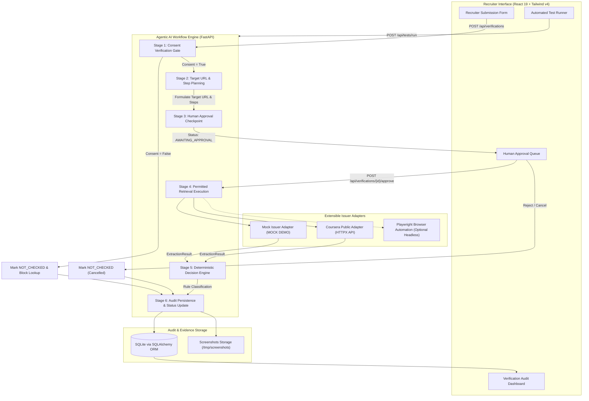

# CertiProof AI — System Architecture & Agent Design

**Team:** Infinity Castle  
**Hackathon:** Ziro.Digital Agentic AI Hackathon 2026  
**Problem Statement:** Certificate Authenticity Checker  
**Industry:** Education & Career AI  

---

## 1. Executive Summary

CertiProof AI is an auditable Agentic AI system built specifically for recruitment teams to verify candidate certificate claims against permitted public course-platform issuer verification portals.

Unlike traditional dashboards that execute blind API queries or mock prototypes that invent verification statuses, CertiProof AI enforces a **6-stage deterministic agent execution lifecycle** featuring:
- **Mandatory candidate consent validation** before any lookup occurs.
- **Explicit Human-in-the-Loop (HITL) approval gates** before navigating to external platforms.
- **Deterministic rule-based classification** (never allowing generative hallucinations to confirm or deny records).
- **Relational audit trail persistence** storing full evidence payloads, timestamps, and retrieval metadata.

---

## 2. High-Level Architecture Diagram



---

## 3. 6-Stage Agent Lifecycle Specification

### Stage 1: Candidate Consent Gate
- **Purpose:** Enforce legal compliance and candidate data sovereignty.
- **Rule:** If `candidate_consent == False`, the agent halts immediately.
- **Behavior:** No issuer adapter is initialized, no external network request is dispatched. The record is persisted with status `DONE`, outcome `NOT_CHECKED`, and reason `"Candidate consent was not provided. No issuer lookup was performed."`

### Stage 2: Step Planning & Adapter Resolution
- **Purpose:** Resolve the correct issuer adapter and formulate the verification plan.
- **Mechanism:** The `issuer_slug` is matched against the `ADAPTER_REGISTRY` (e.g., `mock-issuer`, `coursera`). The agent computes the parameterized URL template (e.g., `https://www.coursera.org/account/accomplishments/certificate/{credential_id}`).
- **State Transition:** Agent run state advances to `PLANNING`.

### Stage 3: Human-in-the-Loop (HITL) Approval Gate
- **Purpose:** Prevent unauthorized automated queries and enforce supervisory control.
- **Mechanism:** The agent records an `ApprovalDecision` row with `decision="PENDING"` and execution target details. The verification status transitions to `AWAITING_APPROVAL`.
- **Action:** The recruiter inspects the proposed destination, credential ID, and purpose in the **Approval Queue**. Execution resumes only when the recruiter clicks **Approve**.

### Stage 4: Permitted Evidence Retrieval
- **Purpose:** Extract ground-truth verification data from the issuer platform.
- **Mechanism:** The designated adapter executes the query using `httpx` or headless browser automation.
- **Traceability:** Captures HTTP response payloads, extraction timestamps, source URLs, and screenshots. Mock results are unambiguously flagged with `is_mock = True` and labeled `MOCK`.

### Stage 5: Deterministic Decision Engine
- **Purpose:** Compute conclusive verification status without generative hallucination.
- **Decision Hierarchy:**
  1. If candidate consent is absent $\rightarrow$ `NOT_CHECKED`.
  2. If human approval was denied $\rightarrow$ `NOT_CHECKED`.
  3. If retrieval produced an error or blocked $\rightarrow$ `UNRESOLVED`.
  4. If issuer registry returned 404 / no record $\rightarrow$ `NOT_FOUND` *(explicitly noted as not necessarily indicating fraud)*.
  5. If candidate name does not match evidence $\rightarrow$ `MISMATCH` *(flags `candidate_name`)*.
  6. If course name explicitly contradicts evidence $\rightarrow$ `MISMATCH` *(flags `course_name`)*.
  7. If candidate name and course align $\rightarrow$ `VERIFIED`.

### Stage 6: Audit Persistence & Reporting
- **Purpose:** Store immutable verification history for enterprise compliance.
- **Storage:** Persisted across relational tables: `VerificationRequest`, `ConsentRecord`, `AgentRun`, `ApprovalDecision`, `EvidenceRecord`, and `OutcomeRecord`.

---

## 4. Issuer Adapter Pattern

All issuer implementations inherit from the abstract `BaseIssuerAdapter`:

```python
class BaseIssuerAdapter(ABC):
    name: str
    slug: str
    base_url: str
    
    @abstractmethod
    async def verify(self, credential_id: str, **kwargs) -> ExtractionResult:
        """Query issuer and extract candidate proof."""
        ...
```

| Adapter | Identifier | Target Platform | Retrieval Strategy |
| :--- | :--- | :--- | :--- |
| **Mock Issuer Adapter** | `mock-issuer` | `https://mock.certiproof.local/verify` | Deterministic fixture lookup for TC1–TC4 test cases. Labelled `MOCK`. |
| **Coursera Public Adapter** | `coursera` | `https://www.coursera.org/account/accomplishments` | Direct HTTP GET against Coursera's public `/api/accomplishments.v1/` endpoint. |

---

## 5. Security & Privacy Guarantees

1. **No Accusatory Defaults:** A `NOT_FOUND` record indicates lack of match in public records, never a fraudulent accusation.
2. **Audit Immutability:** Step timestamps, approval decisions, and raw response payloads are written to SQLite.
3. **Serverless Ephemeral Storage:** In production on Vercel, the SQLite database resides in `/tmp/certiproof.db`, avoiding persistent leakage of sensitive recruiter inputs.
